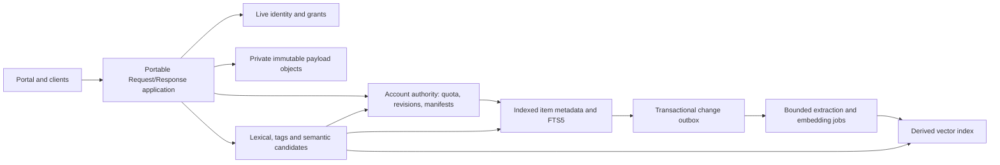

# Storage, search and operating cost

Status: proposed target architecture, reviewed against source and official provider documentation on 2026-10-11. This document does not establish deployed capacity, live Polar integration, semantic relevance, or production readiness. The user-requested plans remain **500 MB (0.5 GB) free, Paid 5 GB for $5/year, Plus 100 GB for $35/year, and Ultra 1 TB for $250/year**. Use decimal GB (1,000,000,000 bytes), versioned configuration and explicit annual billing. Prices are a product requirement; financial viability is provisional. Decisions and implementation reconciliation belong in [DEVLOG](../../DEVLOG.md); independent findings are in [scaling review](../release/scaling-review.md).

## Current implementation and limits

The portable controllers already separate policy from Worker/Node persistence. Worker accounts have individual Durable Objects and R2 payloads; Node has per-account SQLite files and private blob files. This is a useful ownership boundary, but the presence of SQLite does not mean queries are indexed SQL: both current adapters expose a generic key/value metadata API.

| Evidence | Present behavior | Scaling consequence |
| --- | --- | --- |
| `apps/worker/index.mjs`, `IdentityRepository` | All account identity records/handle/email claims use `directory-v1`; device requests use `devices-v1`. | Shared identity traffic converges on one authority; adding account objects does not remove it. |
| `AccountController.invoke`, `apps/worker/objects.mjs` | An account gate spans the complete operation, including external I/O. Worker uses `blockConcurrencyWhile`; Node uses a serial promise gate. | Slow blob/provider work causes head-of-line blocking within a busy account. |
| `packages/messaging/messages.mjs:list` | Reads all message metadata, filters/sorts, then slices. | O(N) reads and O(N log N) sorting even for a 50-item page. |
| `AccountController.snapshot`, `packages/runtime/http.mjs` | Account and message endpoints use a newest-100-message snapshot, alongside other account lists. | A snapshot is neither complete history nor a basis for all-items search. |
| `AccountController.hostedOperation` | Hosted list scans prefix metadata, sorts, slices and rejects cursors. | Large namespaces require real keyset pagination. |
| `AccountController.alarm/warm` | A complete selected-metadata JSON archive is read/written/restored; bounds are 2,000 rows and 8 MiB. | Archive is a safety-bounded local mechanism, not a scalable cold tier. Hosted object rows, receipts and journals are not all shelved. |
| `packages/runtime/http.mjs`, hosted resource descriptor | Message transport and hosted objects have a 1 MiB payload ceiling; default JSON body bound is 100,000 bytes, with separate message bounds. | Storage allowance does not imply support for a 100 GB file or even a 1 MiB JSON RPC payload. |
| `apps/node/resources.mjs` | SQLite queries synchronously materialize records; open account/abuse database maps have no eviction. | Single-process deployment has event-loop, memory and file-descriptor ceilings. |

At audit baseline message storage also had fixed 50 MiB/1,000-message and separate hosted-storage counters. The plan/quota implementation in this work may supersede those constants; changing constants alone does not resolve the scan, archive, upload or search limits above. Tests and the ledger must name exactly which target interfaces below have actually landed.

## Authoritative data and portable interfaces

Keep one logical account authority. Store bounded metadata and indexed fields in SQL; store original bytes and large extracted documents in immutable object storage. Small accounts start in one SQL shard. A large account can later route content partitions through its account manifest without changing public item IDs or quota ownership.

Proposed injected contracts are semantic, not cloud-specific SQL handles:

| Contract | Required behavior |
| --- | --- |
| `ItemRepository` | Atomic per-account mutation, revision check, point reads, indexed keyset pages, typed filters and live authorization metadata. |
| `UsageRepository` | Transactional byte/item reservations, entitlement revision, commit/release, durable reconciliation cursor. |
| `BlobStore` | Stream/range reads, immutable conditional creation, verified size/checksum, multipart lifecycle and idempotent deletion. |
| `SearchIndex` | Bounded lexical candidates, exact tag intersection, revision-aware upsert/tombstone, model/extractor generation and health watermark. |
| `EmbeddingProvider` | Explicit model ID/dimensions, bounded batch/token input, timeouts, cost meter and capability state. |
| `VectorIndex` | Tenant-isolated upsert/delete/query, generation and item revision, eventual-consistency status; no authorization decisions. |
| `JobQueue` | At-least-once delivery, lease/fencing token, retry/backoff, bounded batches, dead-letter diagnostics and replay. |

Cloudflare adapter: SQLite-backed account DO for metadata/FTS, R2 for payloads, queue/alarm-backed bounded jobs, optional Workers AI/other embeddings and Vectorize. Node adapter: SQLite with verified FTS5 support, filesystem/S3-compatible blobs, persistent job table plus worker process, configurable local embedding model and persistent vector service. Node remains one process until cross-process locking/routing has a real implementation. An in-memory vector fallback is development-only and cannot advertise production semantic capacity.

Cloudflare explicitly documents FTS5 support, including `fts5vocab`; application SQL transactions use its transaction APIs, and cursors must be consumed before an `await`. This supports the adapter choice but is not evidence that this repository has created FTS tables or passed adapter conformance. [SQLite DO API](https://developers.cloudflare.com/durable-objects/api/sqlite-storage-api/)

Use a common adapter suite for transaction rollback, concurrent reservations, stable cursor ordering, FTS Unicode/tokenization, exact tags, escaped query syntax, deletion and crash recovery. Report backend differences as capabilities rather than silently changing semantics. Probe FTS support during installation and reject an advertised lexical capability if absent.

## Unified items, paging and working set

An item has `accountId`, stable `itemId`, `kind`, `resourceId`, `collectionId`, `createdAt`, `updatedAt`, monotonic `revision`, `contentRevision`, `aclRevision`, `mimeType`, `payloadRef`, logical byte size, content digest, owner tags, quarantine/read flags and optional tombstone. A message is an item with message-specific fields; a hosted object is an item with key/version fields. Module adapters can contribute documents such as publications through the same boundary. Remote connectors contribute only explicitly authorized indexed metadata/content; merely configuring a provider never makes its entire contents searchable. Credentials, recovery material and private capability URLs are excluded from extraction.

Keep owner tags separate from sender annotations. Normalize tag identity deterministically; represent tags in `(account,item,normalizedTag)` rows with `(account,normalizedTag,item)` lookup indexes. Suggested item indexes are `(account,collection,createdAt DESC,itemId DESC)`, `(account,kind,createdAt DESC,itemId DESC)` and `(account,resource,key)`, with measured partial indexes for unread/quarantine. Persist counters separately; a homepage must never calculate them by scanning the inbox.

Default page 50, maximum 100 records. Opaque versioned authenticated cursors bind account, filter digest, order and last `(createdAt,itemId)`; reject a changed scope. Use a high-water revision/time boundary when stable traversal is required. An item's deletion between pages may shorten results; no offset pagination or claim of a transaction spanning all pages. Exports use resumable bounded pages. SQL adapter batches respect parameter limits.

Target request working set: at most 100 metadata rows, 64 KiB extracted text per indexed document by default, 200 candidates per retrieval channel, 1,000 total candidate authorizations per request, 32 KiB snippets in the response. These are proposed operational budgets, subject to evidence; extraction bounds must be visible in coverage status. Metadata-only pages do no payload reads. Large uploads/downloads stream outside the account gate, with only reservation/commit serialized. Never put a full inbox, raw vectors or whole extracted corpus in a portal Query or account snapshot. Cache bounded projections; Node must evict idle open database handles and reuse a bounded abuse database instead of indefinitely opening a file per key.

## Quota invariants and crash recovery

Quota is account-wide across hosted message and object payloads, including quarantine and recoverable trash. Free allowance is exactly 500,000,000 bytes. The visible account meter reports committed bytes, allowance and remaining space from this authoritative ledger; pending reservations are accounted in admission and may be shown separately. Do not sum only the current inbox page or treat a browser meter as enforcement. Track logical user bytes separately from provider bytes (old versions, multipart staging, replicas, index data and delayed garbage); all physical bytes still enter cost accounting. Independently bound item count, metadata bytes, receive rate, extracted tokens and retained vectors so millions of tiny objects cannot exhaust the service while remaining below a byte allowance. Publish these operational limits before offering the plans.

The invariant at every new reservation is `committedBytes + reservedBytes + requestedDelta <= effectiveLimit`, plus corresponding item/metadata limits. Usage totals can decrease after deletion; the **ledger revision and mutation sequence never decrease**. Do not confuse monotonic revisions with monotonically increasing storage consumption. Idempotency binds account, operation ID and immutable request digest.

1. In a short SQL transaction check live authorization/entitlement and reserve bounded bytes/items with expiry and a fencing token. Persist the upload intent before object writes.
2. Stream to an account-scoped immutable staging key. Enforce actual byte count, MIME validation and digest. Never trust a client-declared content length or authorize an unlimited presigned upload.
3. In a second short transaction recheck authority, fencing token, object identity and expected item revision; atomically commit item metadata, counters, receipt, and search/notification outbox. Convert reservation into committed usage exactly once. A revoked grant or downgrade can reject commit; it must not orphan untracked storage.
4. On failed or expired intent, persist compensating deletion. A reconciler scans durable intents with bounded cursors, confirms object state and removes or adopts it. Replayed commits return the stored result, and stale workers cannot resurrect expired intents.

Replacement uploads must reserve any added logical usage and separately bound temporary physical overlap. Deletion atomically tombstones metadata, updates logical counters and creates blob/index cleanup tasks. Physical deletion is retried idempotently; retain tombstones until all index generations/jobs and relevant backup windows are reconciled. Garbage records themselves need retention and alarm/queue progress. Releasing reservations without cleaning physical staging is not sufficient. R2 and SQL do not share a transaction; a blob put inside a SQL callback cannot confer cross-service atomicity.

Downgrades never delete customer data to fit a lower plan. They mark an over-quota state, allow read/export/delete, and reject net growth until usage fits. Failed renewals follow a configured grace policy. Billing events are verified, deduplicated and reconciled against trusted subscription state; event arrival order is not entitlement ordering. Store a local increasing entitlement revision tied to the reconciled provider state. Browser checkout success alone changes no allowance. Plan/product/environment mappings are explicit, and missing keys leave billing unavailable.

## Omni-search and consistency

The omni-search scope is all authorized contributed items, not just loaded messages. Define supported `kind:`, `tag:`, collection, date, sender and resource filters with a bounded parser. Treat terms as data; raw FTS expressions and SQL fragments are never interpolated. Exact tag filtering is independent of lexical and semantic rank. Tag-only queries must work without an embedding service.

Lexical search uses FTS5 over safe extracted title/body and selected owner metadata. Semantic search uses bounded text chunks and an explicitly named embedding model; term expansion, hashing or substring matching must not be presented as learned semantic retrieval. Query both channels, apply required exact filters, combine rank using documented reciprocal-rank fusion, deduplicate by item and then produce authorized snippets. When the embedding service is unavailable, return lexical/tag results plus an explicit degraded semantic state. An empty semantic result is distinct from unavailable or not-yet-indexed content.

The write transaction emits `(accountId,itemId,revision,contentRevision,aclRevision,operation,generation)` into an outbox. Workers extract safe text without executing HTML, external fetches or archive recursion; use bounded MIME-specific parsers, archive expansion limits, deadlines and a content-digest cache. Jobs carry expected revision and fencing tokens. Index records include revisions; writes are idempotent. A slow old upsert cannot override a newer tombstone. With vector services that lack compare-and-swap, use versioned vector IDs and current-generation manifests, reject stale candidates, and garbage-collect superseded vectors.

Before retrieving snippets or payloads, resolve each candidate through authoritative metadata and current grants: require account ownership, live item, matching content/ACL revision, current resource access and applicable quarantine filter. Reject stale/foreign hits even when an index tenant filter was supplied. Never put plaintext snippets in a shared vector response used before this check. ACL changes fail closed immediately even if physical index removal is delayed. A bounded second fetch may fill short results; if the candidate budget is exhausted, return a partial-result indicator. Postfiltering is required for safety but can reduce recall; evaluate it explicitly.

Rebuild with a separate generation from a bounded high-water item scan, followed by replay of the change log through a recorded revision. Verify counts/digests, authorization canaries and relevance before atomically switching the active generation. Keep the old generation only for a bounded rollback interval; tombstones apply to both. Track coverage as searchable/eligible/failed/pending/truncated items, oldest pending event and indexed revision. Deletion/export includes derived text, embeddings and queued copies according to the documented backup retention policy. Hosted operator access to plaintext/embeddings remains within the existing custody model; embedding-provider disclosure must be explicit.

## Cold accounts and identity growth

Do not extend the current whole-account 8 MiB JSON archive by merely increasing its limit. Keep a small authoritative manifest, usage/entitlement state, tombstones and authorization records available. Export immutable bounded metadata/index segments with schema version, checksum, account, key range and high-water revision. Commit the manifest only after readback verification; reclaim hot rows after that durable pointer exists. Rehydrate only the needed segment or launch a resumable restore, reporting unavailable/search-warming status honestly. Cold search cannot silently exclude archived items; either retain a compact searchable index or state that complete search awaits restoration. Rebuild jobs must not rehydrate an entire account into memory. Budget restore storms and avoid a timer or polling loop per inactive account.

Partition identity storage separately from content. First move account envelopes/sessions to account-hash partitions and retain a narrow strongly consistent claims directory. Later shard canonical handle/email claims by deterministic hash using a durable multi-step claim intent, unique claim fencing and reconciliation; no best-effort cross-shard duplicate-email check. Account creation/linking becomes visible only after all required claims commit. Shard device requests by opaque request ID; rate-limit invalid lookup attempts before awakening account state. Do not cache positive authorization beyond revocation guarantees to hide a hot global registry.

## Marginal cost and plan budget

USD list-price snapshot, 2026-10-11. Recheck before launch and quarterly. Provider included allowances are shared across the entire deployment, not a free allocation for every user. Model marginal usage before allowances; then apply provider rounding/minimums once to aggregate invoices. No live account billing plan has been inferred.

R2 Standard storage is $0.015/GB-month; writes/lists are $4.50/million Class A requests and reads $0.36/million Class B requests, with no internet egress charge. Free allowances and different Infrequent Access retrieval/minimum-duration economics must be modeled separately. [R2 pricing](https://developers.cloudflare.com/r2/pricing/)

SQLite DO overage is $0.20/GB-month, $0.001/million rows read and $1/million rows written, after deployment-wide included usage. Index/FTS maintenance adds writes. DO compute overage is $0.15/million requests and $12.50/million GB-seconds, with a $5/month Workers paid base; idle objects must be eligible to hibernate. These exclude other Worker/queue services. [DO pricing](https://developers.cloudflare.com/durable-objects/platform/pricing/)

Polar Starter is 5% + $0.50 per transaction. This model assumes one domestic annual payment, no tax and no extras. International cards add 1.5%; payout, FX and dispute fees also matter. Older eligible organizations can have Early Member rates, but no eligibility is assumed here. Fees can apply to the tax-inclusive transaction amount. [Polar pricing](https://polar.sh/resources/pricing)

| Plan | Annual gross | Starter fee in base scenario | R2 at 100% payload occupancy all year | Remaining before all other costs |
| --- | ---: | ---: | ---: | ---: |
| 500 MB free | $0 | $0 | $0.09 | **−$0.09** |
| 5 GB | $5 | $0.75 | $0.90 | **$3.35** |
| Plus 100 GB | $35 | $2.25 | $18.00 | **$14.75** |
| Ultra 1 TB | $250 | $13.00 | $180.00 | **$57.00** |

Arithmetic: `annualPayload = quotaGB × occupancy × 0.015 × 12`. Full 100 GB is $18/year before operations, metadata, search, embeddings, backups, email, support and billing extras. A second full retained copy doubles that payload cost to $36, exceeding the new $35 gross. At 20% occupancy the R2 terms are $0.018/$0.18/$3.60/$36.00, but average underuse is not a guarantee against full-use customers or abuse. One fully occupied free account costs real money. Subsidy must be explicit: at most about 37 full free accounts consume a small paid account's entire $3.35 residual, leaving nothing for operations.

Vectorize's current formula is based on dimensions and stored vectors plus query count, **not a scan of every stored vector per query**. Before allowances, for `N` vectors, `Q` monthly queries and `D` dimensions: `monthlyVectorUSD = (N+Q)×D×0.01/1e6 + N×D×0.05/1e8`. Paid included allocations are shared. Embedding inference is separate. Recheck actual invoice behavior against this estimate. [Vectorize pricing](https://developers.cloudflare.com/vectorize/platform/pricing/)

| Illustrative account corpus | Model dimensions | Queries/month | Vector estimate/year before allowances and embedding |
| --- | ---: | ---: | ---: |
| 10,000 chunks | 384 | 300 | $0.50 |
| 100,000 chunks | 384 | 3,000 | $4.98 |
| 1,000,000 chunks | 768 | 3,000 | $97.04 |

These are calculations, not predicted usage or recommended per-plan allowances. At 100,000 chunks even the vector term alone exceeds the small plan's $3.35 residual. Item count and content shape matter more than raw quota for search. Start with one compact embedding per eligible small item; add chunks only within measured allowances. A million tiny messages must not trigger a million unbudgeted embeddings on a $5 subscription.

Use a cost ledger per account/cohort: payload byte-hours, retained physical byte-hours, SQL bytes, rows read/written, R2 operations, request/CPU/duration, extracted tokens, embedding model/tokens, vector dimensions, queue attempts, email, observability and payment costs. Estimate `embeddingUSD = indexedTokens×providerRate + queryTokens×providerRate`, with actual rate/unit stored in versioned provider configuration. A 10 MiB SQL footprint alone is about $0.025/year; a 1 GB metadata/index footprint is $2.40/year. FTS write amplification, retries and rebuilds must be measured rather than assumed zero.

Provisional planning cap after payload/payment: spend at most 50% of the residual on recurring technical variable costs, retaining the other half for support, shared overhead and variance. That leaves $1.675/year on 5 GB and $5/year on 100 GB at full occupancy. Free accounts require a deployment-wide approved subsidy envelope. Set configurable embedding-token/vector/query budgets from those envelopes, alert at 70%, pause optional background enrichment at 90%, and continue safe lexical/tag access when semantic budget is exhausted. Display coverage/budget degradation, avoid silent charges or deletion. These are operating proposals; promised allowances/pricing changes need an explicit product decision.

## Migration triggers and measurable acceptance

The following are proposed decision triggers and acceptance targets, **not benchmark results**. Instrument queue wait, CPU, memory, rows/bytes examined, payload reads, contention and invoice counters before setting user capacity claims.

| Trigger | Required action |
| --- | --- |
| Before advertising paid multi-GB storage or complete-history search | Implement indexed paging, aggregate quotas, resumable ingest, safe tombstones/outbox, and replace or explicitly gate the small archive mechanism. Storage headroom cannot compensate for inaccessible history. |
| Any account reaches 1,000 metadata rows, a listing reads >10× its returned rows, or p99 listing exceeds 300 ms over three 15-minute representative windows | Complete/query-plan-verify SQL list/filter indexes; remove full scans from that request path. |
| Account queue wait p99 >50 ms at its admitted rate, or I/O occupies >50% of gate time | Move streaming/provider/embedding work outside the account gate; retain fenced short commit transactions. |
| Identity queue wait p99 >50 ms or sustained load exceeds 25% of measured single-directory saturation for three 15-minute windows | Migrate envelopes/sessions off the directory and execute verified claim-shard plan. |
| Metadata plus FTS reaches 2 GB/account or projects 4 GB within 90 days | Begin content-partition migration; complete before 5 GB. Preserve quota and identity authority, bound query fanout initially to four shards. |
| An archive exceeds 1,000 rows or 4 MiB (50% of current bound) | Disable further whole-snapshot shelving for that account and use bounded segments; never delete warm rows without a verified restorable archive. |
| Search indexing lag p99 >60 s for 15 minutes or oldest job >10 min | Apply tenant fair scheduling/backpressure, investigate extraction failures; scale bounded consumers within cost ceiling. |
| Measured variable cost forecast exceeds the cohort budget at 70%/90% | Alert / defer optional enrichment and investigate; do not raise customer prices automatically. |

Cloudflare currently documents 10 GB per paid SQLite DO, single-threaded execution and an approximate 1,000 request/s soft object limit. SQL has 100 bound parameters/query and 2 MB row limits. Treat provider maxima as ceilings, never promised application throughput. The earlier thresholds deliberately preserve headroom. [DO limits](https://developers.cloudflare.com/durable-objects/platform/limits/)

Execute both adapters' correctness suites first, then an isolated staging load suite with synthetic nonpersonal data and a capped spend. Matrix: 1k/100k/1m accounts; 100/10k/100k/1m items for selected accounts; 0.5/5/100 GB payload occupancy; 1 KiB/64 KiB/1 MiB item mixes; 50%/90% inactive populations; tenants with 100k tiny items; multilingual text and hostile archive fixtures. Generating virtual size metadata is useful for algorithmic tests but does not establish actual 100 GB upload/restore cost or durability.

Use 80% reads/10% ingest/5% edits/5% search as one baseline, plus a search-heavy run. Model Zipf traffic, a single hot account at 10/50/100 admitted requests/s, 30-minute bursts at 5× aggregate rate, concurrent device edits, webhook duplicates/reordering, 10% cold-account restoration bursts and upstream 429/timeout faults. Sweep until saturation and report it instead of choosing only a passing low-load point. Include a 24-hour soak and a regional network-latency run.

Targets at the declared admitted load: metadata list p99 ≤300 ms, local lexical/tag p99 ≤500 ms, hybrid p99 ≤1.5 s with explicit semantic timeout/degradation, bounded memory independent of corpus size, index lag p99 ≤60 s, and zero quota overshoot/unauthorized hits/lost committed items. Report warm and cold p50/p95/p99 separately, error/429 rates, accepted versus offered throughput, row-read amplification, gate wait, bytes retained after failed writes and total/provider-marginal cost. Cold restoration gets its own measured SLO; no warm-latency promise is inferred.

Crash-inject after reservation, object completion, metadata commit, outbox lease, vector upsert, delete and archive-manifest swap. Verify repeated restarts, no duplicate charges/counter changes, read/export after downgrade, restore reconciliation and scoped backup recovery. Canary evaluation must include related-language meaning queries absent literal overlap, exact tags, item revisions, poisoned cross-tenant candidates, revoked grants and tombstone replay. Relevance needs a labeled corpus and reported recall/nDCG, not just successful HTTP status.

## Provisional decisions and evidence slots

| Decision | Rationale / next evidence | Human reviewer | Date | Outcome |
| --- | --- | --- | --- | --- |
| Per-account SQL metadata plus immutable payload store | Indexed-page/query-plan and failure-injection evidence on Worker and Node | ___ | ___ | ___ |
| Unified items and derived hybrid search | Supported-source coverage, ACL adversarial suite, multilingual relevance corpus | ___ | ___ | ___ |
| Configurable requested annual plans | Actual provider fee tier, cohort occupancy/search costs, full-use stress scenario | ___ | ___ | ___ |
| Segmented cold tier and identity partition migration | Recovery drill, migration rollback, directory saturation benchmark | ___ | ___ | ___ |

Unsigned decisions remain provisional and do not block reversible development. None authorizes enabling production release gates without the existing security, billing, provider and operational evidence.
