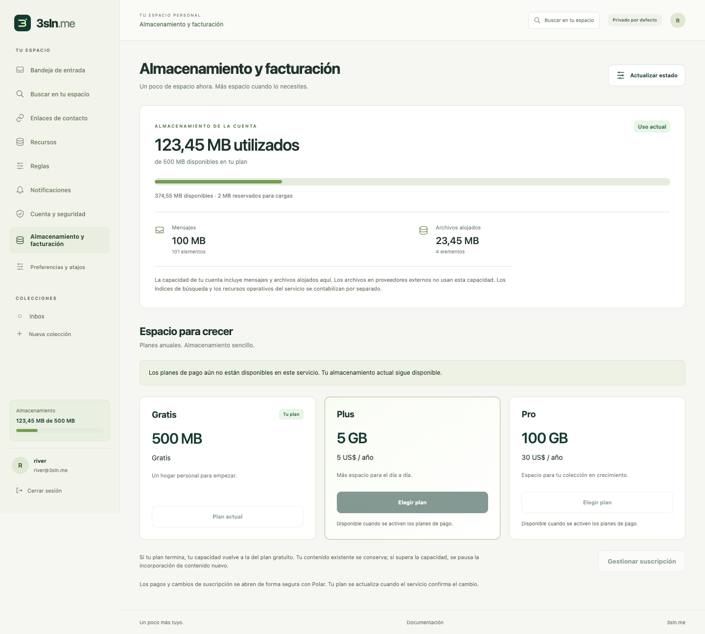
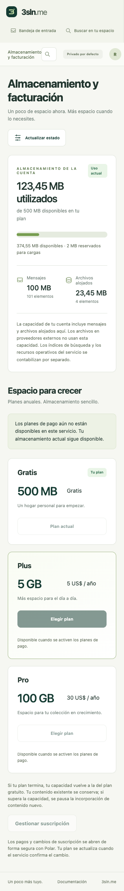

# Local app walkthrough

Captured from the actual local Wrangler app and real Chrome, 2026-10-11–12. These are test accounts; no live recovery credentials, contact capabilities or private answers appear in the images. **Production release remains disabled.** External-provider setup, notification delivery, full federation and account-retention/deletion still require the work recorded in [DEVLOG](../DEVLOG.md).

The new encrypted recovery flow passed real passkey and password signup, restoration, file rotation and replay rejection, with independent adversarial checks. Personal information remains vulnerable to offline guessing; the UI recommends an extra private passphrase.

## 1. Start with an identity

Public documentation, self-hosting links and language selection remain accessible without an account. Local signup offers passkeys or a password, terms acknowledgement, then mandatory recovery setup.

## 2. Choose how to unlock the recovery file

Select one to twelve questions, choose a type and add optional public hints. Every answer contributes to encryption. A private passphrase is recommended because personal information can be guessed offline. Demo question names intentionally resemble navigation labels to check that user content remains unchanged.

## 3. Download only the encrypted file

The random server recovery credential is inside the encrypted payload. Questions, types and hints are readable; answers and credentials are absent from the downloaded public fields.

## 4. Test every answer before activation

A successful local round-trip is required before account confirmation. It tests the in-memory encrypted envelope; the user must still keep the downloaded copy safe.

## 5. Confirm the file is saved

Account activation follows a tested unlock and explicit saved-file acknowledgement. Wrong answers do not reset the account or reveal which answer was wrong.

## 6. Recovery on a narrow phone screen

The question editor fits 320-pixel and 390-pixel viewports. Reordering questions preserves native answer controls; no answer is projected into application state.

## 7. Localized controls, unchanged personal content

Spanish restoration uses the same encrypted format and normalization. Public prompts and hints from the file remain user content and are never translated.

## 8. A private inbox

Signed invitations deliver bounded messages into allowed collections. Owner read status, collection moves, rules and quarantine are separate from untrusted sender annotations.

## 9. Control each invitation

Each contact endpoint has its own scope, expiry and limits. Quarantine or revoke it independently. Opening the signed URL does not deliver a message or consume its message quota.

## 10. Manage access to the account

Enroll multiple passkeys, review signed-in devices and revoke sessions. Email linking and optional email sign-in remain disabled until the outbound service is configured.

## 11. Choose resources with clear availability

S3-compatible and WebDAV setup are available behind reviewed endpoint rules. OAuth providers are visibly unavailable until their applications, flows and conformance are configured; this screenshot does not establish working external-provider delivery.

## 12. Choose notification channels

Preferences include channels, delays, repeat limits and collections. Hosted push/reminder delivery is still a release gate; storing preferences is not evidence of real delivery.

## What these checks establish

The isolated browser suite exercises maintained Argon2id in a dedicated worker, Node/browser interoperability and the archived seven-type vector, malicious public metadata, wrong answers, wrong-provider files, duplicate submits, cancellation, real virtual-authenticator WebAuthn and full recovery rotation. Mobile layout and Spanish/user-content checks run separately. Production CAPTCHA, physical devices, low-memory performance, inbox delivery and all external storage providers remain separate verification.

## 13. See storage usage and annual plans

The visible account meter shows 500 MB on the free plan, reserved uploads and a messages/files breakdown. Plus is 5 GB for $5/year; Pro is 100 GB for $30/year. Checkout remains disabled until Polar setup and verification. These additional screenshots use the actual Chrome-rendered portal with explicitly mocked account/API data to exercise UI states; they do not prove live billing or deployed storage capacity.

## 14. Search messages across the account

Lexical and tag search support bounded cursor pages, index-lag notices and opening messages outside the initial inbox page. Semantic search remains unavailable until its provider is configured and verified. User-authored titles and snippets retain their language and render as inert text.

## File beaming and nearby pairing

Paid senders can select several files, choose a registered device or saved contact, and review the names and declared size. Nearby QR pairing does not require a saved contact. The recipient chooses which files to receive; remote offers appear on eligible devices and only one device can accept.

These screenshots use explicitly mocked paid-account/API fixtures. Browser tests exercised native WebRTC between two local portals and verified selected-file bytes; they do not establish internet NAT traversal, TURN relay, push delivery or real paid entitlements. Streaming uses a user-approved file destination where supported, with a bounded 32 MiB memory fallback elsewhere. TURN remains disabled pending credentials and an enforceable relay-spend budget.

## Agent consent and connected apps

The HTTP MCP consent page identifies the requesting app, callback origin and signed-in account. Every collection/action checkbox starts unchecked. Deletion has a separate warning; the user can deny the request. Connections can be revoked in the portal.

These screenshots use mocked authorization-request metadata. Separate actual Worker tests verify PKCE, audience, scoped tools, refresh rotation and revocation. An upstream app/MCP resource importer remains a design, not a deployed feature.

## Conversations and reply-all

Every conversation message targets the full active membership. The recipient list and per-recipient delivery outcomes stay visible; a partial delivery never appears as complete. Shared-secret authors are labeled unverified. Joining, invitations, individual permissions and removal each have explicit controls.

These screenshots use mocked conversation records/delivery outcomes. Durable Node and real local HTTP tests separately verify posting, admission, reply-all, epoch rotation, restart and sanitized inbox/search content. General cross-host federation and production conformance remain gated.

## Visible monthly activity and semantic consent

Storage and monthly covered-change usage each show remaining capacity. Exhaustion preserves account reading, export, deletion and security controls. Semantic search requires explicit consent for limited English excerpts to be processed by Workers AI.

These images use bounded API fixtures. Real Workers AI inference and insertion/query/deletion checks ran separately against all four hosted Vectorize shards.

## Connected app resources and disconnection

Connected apps now tracks the app connection independently of its individual agent logins. Review the app's identity, presentation source, resource URL and granted collections/actions. Revoking one agent login leaves the connection intact; disconnecting the app stops new calls and invalidates the connection's tokens and grants. Owner data stays in its resources. Reconnecting requires fresh consent and cannot revive old credentials.

These screenshots use explicitly mocked app/manifest/grant records. Separate real Worker tests verify listing, CSRF-protected disconnection, token and refresh denial, and storage preservation. Independent durable tests cover reconnect generations, pending consent, corrupt records and final dispatch checks. A failed grant listing leaves healthy app disconnect controls available.

Names/descriptions may come from Bindle app metadata or linked/discovered web app manifests. The UI keeps the registered identity and source visible, uses initials, and never loads external icons automatically. Optional Node discovery has a verified DNS-pinned adapter and passed a read-only public MDN example check. Cloudflare external discovery and a raster icon cache remain unconfigured release work.
